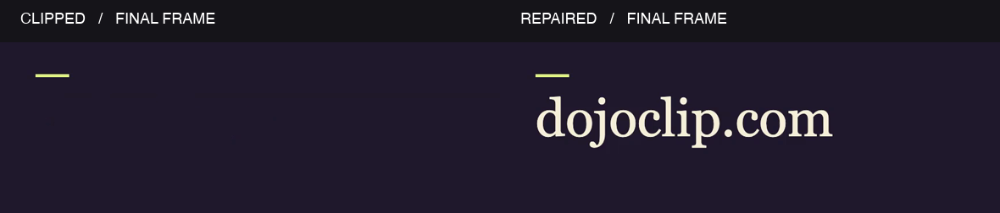

# Readiness execution ledger

Started on 2026-11-01. Last updated on 2026-11-19. The harness plan remains the acceptance contract.

## R28 · required titles and paint order (2026-11-19)

New local-v14 runs freeze a sampled text layout policy. Review identifies
required copy cut by a line limit or clipping ancestor, and text beneath a
later opaque full-canvas background. Errors include the text node and sampled
frame. A temporary entrance cover is allowed if the text has a clear sample.
Unbound requests retain the previous receipt behavior. The two source kernels
share the same regression fixtures, including the centered flex anniversary
layout and exact text declared through stable child paths.

In the commercial editor's eight-second After Hours film, fixing the
one-line cap restored the entire second line. Correcting the misplaced
background restored the full headline. The repaired export contained all
192 frames. The model stage used scripted replies for this verification.
The matching SDK source is web `58b357dc`.

## R28 · preserve the canvas around a 3D edit (2026-11-19)

New local-v14 requests freeze a scene canvas policy. Review and Apply check
the original and resulting documents. Incidental changes to dimensions, frame
rate or an authored canvas alongside a changed Three.js layer require repair.
A deliberately requested global format edit can declare its exact property
and value. An empty project with the stock canvas can choose its initial color.
New guidance places an interval-local backdrop before the mesh at z-index zero.
Saved requests without the policy retain their prior checks and receipts.

The original Noor birthday trial remains recorded as failed. A separate offline
regrade of its saved output passes the revised empty-starter rule. The first
commercial request reconstructs to 78,466 UTF-8 bytes on the GPT adapter.
Future creative evaluations measure the final provider body before reserving
funds and record its byte count. The original 164,171-token provider report and
the outstanding 429 usage investigation remain open.

## R28: recover an interrupted reviewed edit (2026-11-19)

Failed runs with matching, owned verification evidence can now stage the
original checked commands in a new **Review changes** card. Recovery does
not invoke the model, apply an edit, or clear the original run's unknown
usage. A later failed review, a conflicting source, or an incomplete
preview repair cannot authorize recovery. Matching duplicate requests return
the existing child; Apply uses the usual current revision and review basis.

Two offline rehearsals against isolated copies of the original November 18
typography 429 checkpoint produced the exact previously reviewed document
(`sha256:62ba047eb9d27c582d3c23ffa642e55b52696e8cc75ef21b7af1713c119b7e18`).
One exercised the recovery and Apply APIs twice. The browser rehearsal
lost the recovery acknowledgment, reloaded, opened Review, then applied on
explicit click. The final revision advanced once. Neither rehearsal called a
provider or modified the original failure record. This is recovery of existing
work, not a successful rerun of the original live qualification.

For reproduction, `scripts/verify-reviewed-edit-recovery.mts` and
`scripts/verify-reviewed-edit-recovery-browser.mjs` take a stopped fixture
store, a fresh output directory, project ID, run ID and expected reviewed
document hash. The browser script requires a local production build. Both
copy only the selected project file, not provider settings. Local reports
are in `test-results/r28-reviewed-final/` and `test-results/r28-recovery-browser-final/`.

## R28: final frame of an appended ending (2026-11-18)

New local v14 runs bind `endingVisibility: "final-frame-v1"` in their authoring
request. Review, receipt replay, and Review/Apply after a rebase use that saved
choice. Older requests retain the earlier sampling and receipt behavior.

For a declared `appended_ending`, native preflight reserves the composition's
last displayed frame within its existing 24-frame budget. It checks each named
text layer contributing to the exact closing copy. A layer that ends early,
becomes fully transparent in a supported case, has a layout box fully outside
the canvas or supported ancestor clip, or sits behind a later unambiguously
opaque full-canvas rectangle receives a repair message with the layer ID and
frame. Animating into view earlier is allowed. This check does not grade
typography, contrast, partial glyph clipping, complex masks or arbitrary
occlusion; use a rendered preview for those.

The two 1280×720 browser exports used the same ending. In the first, the URL
moved outside its clipping window on frame 239; the previous receipt passed.
In the corrected export the URL remained visible. FFmpeg decoded all 240
frames of each. In the fixed region the bright-pixel counts on frames 238/239
were 10,472/0 before and 10,474/10,474 after. A separately decoded opaque
slate also took the final-frame count to zero, with a different diagnostic
naming the covering layer. No paid model or provider was used.

## November 18 creative library expansion — local candidate

The requested [R27 continuation](creative-skill-expansion-2026-11-18.md) adds four
creative packs, bringing the library to seven visual disciplines and ten
operational guides. Agent `8547e4e`/`cee1d3d` passed the full 1,122-test gate and
build. Matching web and worker archives passed their consumer checks. New short
briefs are opt-in; actual-model/rendered qualification is pending. Accepted
0.2.9 runs and commercial production defaults remain unchanged.

## November 15 release closeout

Harness [PR 14](https://github.com/PansaLegrand/dojo-video-agent/pull/14) merged
as `d779b13bba5b8126b074af0255bd6194af6c2fa6`; all eight public CI checks passed,
including Linux/macOS/Windows startup and actual browser jobs. Package source
remains `08720904cabce071a460f0f4480ece8edc517273`, with current local v14/0.2.9
and unchanged loop 0.2.0/engine 1.2.3. Documentation commits do not change those
package bytes. The 1,028-test local gate, 66 browser checks and 32/32 repeated
live-model workflows below are distinct verification layers, now accompanied
by the public CI result. This is not a claim of a new npm registry publication.

The commercial host separately records worker PR 12 (`583d060`) deployed before
web PR 79 (`37710636`) and a passing signed-in edit/Undo/export/publication
canary. On November 15, the user separately approved the commercial Suno V6 full
track against its saved file hash; the commercial host records that acceptance.
Three distinct commercial Kie Claude tool probes returned HTTP 500, so Claude remains
unqualified. None of those receipts establish general local BYOK generation
parity. Local image/video jobs remain the optional LH-R15 extension; earlier
dated public-CI-pending notes below are historical.

## November 14 candidate stabilization and repeated live evaluation, 0.2.9

The development candidate remains `local-editor-v14` with kit **0.2.9**, loop
**0.2.0** and engine **1.2.3**. Source `0ff2ae4` restores exact saved-build
selection and release provenance; `1491c03` keeps direct review/proposal editing
within the existing coordinator and reduces repeated command schemas. It does
not introduce a second agent framework or require planning for straightforward
edits. New runs use a build identity; retained runs keep their recorded behavior.
The package source is `0872090`; later documentation commits do not change it.

The existing evaluation runner now explicitly selects the current profile rather
than silently exercising the historical v1 host. The 16-case reliability suite
runs each instruction twice. It covers exact edits, source-offset trims,
three-source ordering, image placement, existing bilingual text styling,
follow-ups, restart/questions, locked tracks, missing media/evidence and injected
project text. Both live runs used Kie `gpt-6-1-sol`, exclusively through the allowed
Responses endpoint, on clean source that remained unchanged throughout execution.
No Vercel Gateway, ASR, TTS or media-generation requests were made.

| Measurement | Before, `708aaaf` | After, `0872090` |
| --- | ---: | ---: |
| Executed trials | 32 | 32 |
| Original complete workflow passes | 30 | 32 |
| Saved candidate semantic passes under grader v2 | 32 | 32 |
| First-pass workflow successes | 21 | 31 |
| Workflow successes after validation correction | 9 | 1 |
| Model requests | 101 | 76 |
| Reported input tokens | 1,695,905 | 1,149,541 |
| Reported output tokens | 14,566 | 11,467 |
| Estimated cost at conservative quoted rates | $1.31563 | $0.89656 |
| Median / p95 trial latency | 19.9 s / 62.8 s | 17.6 s / 35.7 s |

Both original before failures were the same compound-edit case. The candidate
preserved the media's implicit zero source start, while the reference trim wrote
an explicit zero. Grader v2 (`0d55b11`) normalizes only absent source-start defaults
on valid media nodes. Wrong nonzero offsets, durations, positions, rates, explicit
null, nested state and unrelated content remain rejected. The unchanged before
report retains **30/32 workflow passes**; a separate checksum-verified regrade
records **32/32 saved semantic outcomes**, with zero provider calls and no project
writes. Those two trials did not reach Apply, and the regrade does not claim they
did. Both after trials completed the normal Apply/replay path. Before regrading
and after evaluation used the same grader fingerprint.

After passed the full current-profile reliability gate with **32/32 workflow
trials**, all critical cases passing, zero missing proposals, zero preservation
violations and zero unknown provider outcomes. Twelve earlier saved-review marker
errors disappeared. One genuine invalid source-offset trim was rejected, corrected
by the model, and then passed. The first title request's message/tool payload fell
from 102,408 to 74,374 bytes, while its reported input tokens fell from 14,877 to
14,089. Total token savings also reflect fewer calls; byte and token reductions
are not interchangeable.

The combined campaign consumed **177 requests and estimated $2.21218**, within
its shared **256-request / $5** ceiling. Estimates use $0.75 per million input
and $3 per million output tokens; these are not invoice verification. Every
request had a persisted reservation before dispatch, and all usage resolved.
Original failures, reports and the separate regrade are retained under the
ignored `test-results/agent-evals/` directory. No paid retry replaced a failed
trial. See [evaluation guide](../evals/agent/RELIABILITY.md) for commands, accounting
and report semantics.

Local release verification passed **1,028 tests**, full TypeScript, integrity
checks and the production build, plus **66 actual browser checks** with scripted
provider HTTP. Browser checks exercise real React, local persistence, preview,
export, decoded media, dependent speech, Apply and Undo; they are separate from
the actual-model semantic evaluation. The subsequent public CI receipt is
recorded above; npm registry publication remains a separate fact.

This bounded two-repeat suite supports the demonstrated editing and recovery
scope. It does not establish broad creative quality, physical-device breadth,
commercial billing acceptance or production deployment. The earlier real
mixed-media and five-minute audio journeys remain regression cases rather than
unseen holdouts. General local image/video job adapters remain the optional
LH-R15 follow-up.

## November 12 derived caption plans, 0.2.8

The immutable kit source is `63af7248f5c7f3bba5415d64fdc0367b4a5410bf`, with
archive SHA-256
`986945fc7a1dbd9a3f0e1c2925a56f14a0f1f17f5a33d1fb06e9133c1fb5a884`
and 61 packaged files. New local runs select local-editor-v14. The commercial
counterpart is commercial-editing-v15. Loop 0.2.0, engine 1.2.3 and the existing
64-model-call/64-tool/32,000-output-token allowance remain bound to their current
contracts. Earlier runs retain their stored profiles and allowances.

Validated `captionPairs` declare the intended bilingual outputs once. The
coordinator validates source scope, evidence, requested ranges and manifests,
then derives missing `caption_pair` checks before freezing the combined list.
All supplied checks remain intact. Matching explicit checks retain their IDs and
values. Conflicts, duplicate identities, unplanned explicit pairs and combined
totals above 12 fail before plan/artifact persistence. `requirements:[]` is valid
when declared pairs provide at least one check. Both arrays empty is invalid.
The existing stages, checklist hashes, manifests, receipts and replay carry the
complete list through the rest of the edit.

Implementation `7ff03a2` adds this planning behavior and versioned metadata.
Host correction `63af724` replays candidate previews with the saved compiler
options and requires the stored profile to match the immutable stage binding.
The focused gate passed **61 tests**, including two source-bound caption pairs,
six batches, nine additional outcomes, complete native review/proposal, saved
candidate replay and invalid declarations rejected before freezing. Exact
archived 0.2.7 tool, skill, inventory and prompt bytes match in all three phases.
Saved-profile preview tests cover local v11 through v14, restart and invalid
profile/receipt rejection.

The coordinated gate passed **968 tests in 99 files**, full TypeScript, integrity
checks and the production build. All **66 actual browser checks** passed against
that build with scripted local provider HTTP. Actual React, filesystem/IndexedDB
persistence, engine preview/export and FFmpeg decoding are recorded in
`test-results/browser-028-63af724/report.json`. Fifteen commercial native-session
tests passed using the installed 0.2.8 kit and the normal test configuration.
These checks made no paid provider calls. Public CI for this candidate is pending.
Live language and creative quality retain their independent acceptance cases and
retained failures.

## November 12 semantic editing guidance, 0.2.7

The immutable kit source is `4ce0d7d8fa5b3d78688063d26cf2e8aa0ed64684`, with
archive SHA-256
`628edc47a0ad7447b99bbe0cdb4a328c6211d658a460283be9fcf14136259b4d`.
New local runs select local-editor-v13 and the commercial counterpart is
commercial-editing-v14. Loop 0.2.0, engine 1.2.3 and the prior 0.2.6
64-model-call/64-tool/32,000-output-token allowance are retained. Earlier stored
profiles keep their original budgets, archives and observations.

Guidance distinguishes verbatim source quotes in `speech_callout` from supported
numeric/percent `speech_highlight` displays. Unit, currency and context labels
use separate items. Check selection precedes requirement freezing. Caption
translation retains each cue's facts, names, numbers, units, reporting periods,
comparisons and negation in that same cue, followed by a cue-by-cue self-check.
Latest-only diagnostics separate display, source-projected start and readable
duration failures. Source evidence, timing and successful receipt semantics
remain bound to the existing native contracts.

The source gate passed **939 tests in 98 files**, full TypeScript, integrity
checks and the production build. Its focused pre-freeze gate passed 28 tests.
The new guidance is visible in planning, caption batching and assembly, with the
same tool names. Archived 0.2.6 schemas, inventory, skills and prompt bytes match
in all three phases. All 66 actual browser checks passed against that production build, using
scripted local provider HTTP and independent output decoding. The retained report
is `test-results/browser-027-4ce0d7d/report.json`. Ten commercial native-session
tests passed against the installed 0.2.7 kit. PR #12 passed all eight public
checks, including Linux, Windows and macOS clean startup, then merged to main
as `04f232a7845a02d48c18c2908c593112e2638066`.
Live per-cue fidelity and long-form creative output use their
own acceptance cases, retained failures and authorized provider usage.
[PR #12](https://github.com/PansaLegrand/dojo-video-agent/pull/12).

## November 12 append repair, 0.2.6 baseline

The 0.2.6 kit source is `664345c`. New runs use local-editor-v12 and its commercial
counterpart commercial-editing-v13. The host freezes 64 model calls with the
existing 64-tool and 32,000-output-token totals. Earlier profile allowances and
archives remain bound to their original runs.

Explicit append mode expands targeted native repair commands against the same
owned verified candidate. Both repair modes validate the full result before
claiming their single correction. Recovery binds the expanded command hash and
requires a second preview. Latest-profile review and final compilation preserve
authored stacking when typed-lane grouping would invert overlapping visual items.

The 0.2.6 full gate passed 933 tests, full TypeScript, integrity checks and the
production build. Its focused pre-freeze gate passed 50 tests. The commercial
native-session/discovery check passed 16 tests against the installed 0.2.6 kit. The kit was frozen once
from `664345cabd0b6843fc24f040861a4b17ca5e026a` with SHA-256
`4d2ca043474d04307798eeec5b456680b6e43a7208b416d0c779d3a1bc8a12b5`.
All 66 actual browser checks passed against the production build, with synthetic
local provider HTTP and independent output decoding. The report and media remain
under `test-results/browser-026-664345c`. Standalone commercial-package and live
provider gates are recorded separately. Public CI retains each candidate's
versioned results. Live-provider creative acceptance
continues under its separate frozen cases, retained failures and provider budget.

Clean-install CI exposed a localhost visual-model import that depended on the
loop package's cached build output. The host now imports the workspace source
entry, matching the other local adapters. This host-only correction in `27c7064`
is present on both release branches and preserves the frozen kit archive.
A fresh exported tree with no `node_modules` or loop `dist` passed setup, full
TypeScript and actual startup/editor/private-settings checks. Local proof is
retained under `test-results/clean-import-026`. Earlier failed CI runs remain
visible. Corrected PRs #10 and #11 each passed all eight public checks, including
Linux, Windows and macOS startup, then merged to main as `b9fd293` and `3dd7c75`.
[PR #10](https://github.com/PansaLegrand/dojo-video-agent/pull/10),
[PR #11](https://github.com/PansaLegrand/dojo-video-agent/pull/11).

## November 12 local runtime and browser adapters, 0.2.5 baseline

New local runs select `local-editor-v11`, kit **0.2.5**, loop **0.2.0** and engine
**1.2.3**. The kit's immutable source is `e822993`, independent from later host,
test and documentation commits. Earlier accepted profiles retain their archived
coordinators, model/tool/skill identity and original allowances.

The coordinated `npm run check` gate passed **914 tests**, full TypeScript,
integrity checks and the production build. **66 actual browser checks** passed
with scripted local providers. Source commit `3e84c24` adds installed grammar
discovery and archive compatibility coverage. Test-only `8c08424` subsequently
passed **16 staged-service tests** and TypeScript, covering latest-profile
planning/assembly output bounds, review/Apply/reload/replay/Undo, and exact old
checkpoint recovery with zero replacement model calls. Public CI for the pushed
candidate is pending. Live-provider and human creative acceptance have separate
records and denominators.

LH-R07 and LH-R20 have owned local HTTP/browser adapters. The retained source
inspection browser proof includes exact consent, original-file sampling, restart
and duplicate delivery. The output proof includes two actual rendered previews,
one correction, a decoded 1280×720/180-frame/six-second MP4 and cached-file
publication after later editing and restart. One encoding, two publication
attempts and one upload were observed. Reports are retained under
`test-results/local-inspection-browser-1794414088805` and
`test-results/local-outputs-browser-1794414090053`.

A read-only inventory check of the actual local browser tool factory and latest
native toolset found the four inspection/preview/export tools. Available tools,
skills and prompt omit `prepare_generated_media`. The existing approved music
workflow remains separate. General local image/video generation is the optional
bounded LH-R15 adapter follow-up in [localhost scope](managed-ui-host-followups.md).

The earlier dated records below retain their original providers, limits and
observed outcomes.

## November 3 follow-up

[Readable overlays](readable-overlays-2026-11-03.md) add deterministic preparation
defaults with 18 focused tests and three actual browser review/export cases.
[Real-media acceptance](real-media-acceptance-2026-11-03.md) adds three licensed
real-footage workflows with independent decoded output and saved-revision checks.
These advance H-03/H-04/H-06 subsets; live-model adoption, physical-phone breadth
and final human acceptance remain open. Engine 1.1.3 candidate qualification is
separate from npm publication and registry-installed consumer adoption.

| Increment | Change                                                                                                                                                             | Proof                                                                                                                                           | Status                                                                         |
| --------- | ------------------------------------------------------------------------------------------------------------------------------------------------------------------ | ----------------------------------------------------------------------------------------------------------------------------------------------- | ------------------------------------------------------------------------------ |
| H-01      | Capability and scope inventory in `readiness-capabilities.md`                                                                                                      | Catalog/scenario/test paths checked against source; no live quality claim                                                                       | Inventory complete                                                             |
| H-02a     | Independent outcome oracle for every baseline turn and selective undo; fault tests for wrong target, source time, extra changes and missing oracle                 | `npm run check`: 201 tests, typecheck, UI hashes and production build passed                                                                    | Complete                                                                       |
| H-02b     | Sanitized per-trial evidence retained before cleanup; hidden reasoning omitted; missing usage is unknown; engine/lock identity recorded                            | Full check: 204 tests and build; subsequent tool-name redaction: 5 focused tests and typecheck passed                                           | Complete                                                                       |
| H-03a     | Real child-process kill/restart checks for interrupted model work, persisted questions, reviewed proposals and duplicate Apply                                     | Two process tests passed; full check: 207 tests, typecheck and production build passed                                                          | Complete                                                                       |
| H-03b     | Separate six-case suite for compound edits, fractional timing, distractors, genuine target clarification, rejected-proposal follow-up and unsupported partial work | Full check: 213 tests and production build passed; baseline 18-case denominator unchanged                                                       | Complete in reference mode                                                     |
| H-04a     | Native ElevenLabs adapter and settings preset; one-call live ASR probe with source hash and independent expected text                                              | 218 tests/build, 25 browser checks and startup/settings check passed; one 8.094-second Scribe v1 call: 24 words, WER 0, source binding verified | Adapter accepted on synthetic speech fixture; broad speech quality not claimed |
| H-02c     | Explicit failure boundaries and exclusive report creation; a new run cannot overwrite earlier evidence                                                             | 218-test full check/build; final evidence/grader regression subset and typecheck passed                                                         | Complete                                                                       |
| H-03c     | Per-project reads and writes share a queue, preserving single-use callbacks and independent projects                                                               | 220 tests/build, 89 focused tests, 25 browser checks; Windows/macOS/Linux CI passed at b1071fa                                                  | Complete                                                                       |
| H-03–H-07 | Independent grading, retained evidence, host/media qualification and live GPT baseline                                                                             | Pending                                                                                                                                         | In progress                                                                    |

Keep failures visible. A model correction after a bad proposal does not erase the
first failure. Model/ASR usage must stay bounded and credentials never enter
committed reports. Runtime or provider changes get focused regressions followed
by the appropriate complete candidate gate.

Current evidence and remaining limits: [execution report](readiness-report-2026-11-02.md).

Gateway follow-up: shared validation now supports explicit `openai/gpt-*` model
IDs. 228 tests/build, 25 browser checks and cross-platform CI passed. Authorized
Gateway runs passed 54/54 baseline and 18/18 extended trials on clean commit
`58632cd`, with 87 and 24 requests respectively. H-05 automated evidence is complete;
human/real-media and additional capability gates remain open. See
[the Gateway report](gateway-readiness-report.md).

## Basic workflows and music — 2026-11-03

The [new implementation and evidence](basic-workflows-and-music-2026-11-03.md)
adds imported-asset discovery, a durable one-instruction join/logo/ASR/translation/
review/export path, local Markdown skill loading and approved Kie music generation
with exactly-once local timeline insertion. Real browser media checks, bounded
live GPT planning/controlled transcript tests and an actual recovered music task
have separate evidence. This advances H-03/H-04/H-06 subsets; it does not close
all roadmap or human-acceptance gates.

The exact 1.1.3 candidate at `2b04163` passed isolated consumer checks:
355 tests, build and 47 browser checks including real media. Engine 1.1.3 is now published and adopted with verified registry integrity;
registry-installed checks also passed.
Human acceptance remains pending after the user chose to review later.

## R29 · staggered title entrances (2026-11-20)

With the staged engine presets installed, a new local v14 run can discover
`kineticSplit`, review its output and propose separately editable text nodes.
Word, grapheme and line entrances share one local clock and end in a reading
hold. A saved chart-only catalog still exposes `dataChart` alone among the new
macros. A saved run without a catalog keeps the published 1.2.3 vocabulary.

The local and commercial kernels produced identical document hashes for a
landscape letter reveal and a portrait word reveal. The commercial editor
exported the landscape film through all 192 frames and restored a manually
changed title unit through Undo. Engine source is `6af441d`. The installed
registry pins and live provider qualification remain as previously recorded.

## R29 · editable radial motion (2026-11-20)

With the radial engine candidate installed, new local-v14 runs can discover
`radialGroup` and author a full ring or partial arc as editable native marks.
Each mark retains a stable identity, fill, geometry and local motion track.
Older chart and kinetic catalogs keep their previous menus and replay.

The local and commercial hosts reviewed the same Solar Bloom project and
produced identical hashes. Its 26-petal outer flower required 243 bytes of
macro JSON. In the commercial editor, changing the width of the fourth petal
preserved every other mark and Undo restored the original project. Engine
source is `1a650b2`. The asset-free eight-second H.264 decoded through all
192 frames. The hosted model and release remain outside this verification.

## R29 · editable UI walkthroughs (2026-11-20)

The walkthrough catalog adds `uiWalkthroughCard` on top of the radial catalog.
It expands supplied steps into native labels, details, status marks and a
pointer. A new session can revise step two through a normal reviewed edit,
preserving the other rows and the cursor timing. Saved chart, kinetic and
radial sessions keep their original macro menus and compilation behavior.

The local and commercial hosts produced identical landscape and Chinese
portrait documents. The eight-second Cut Room export advances at frames
64 and 128. The database-backed commercial browser check edited just the
middle label, then exercised Undo, Redo, reload and export. Engine source
is `c141423`. Publication and hosted-model qualification remain separate.
