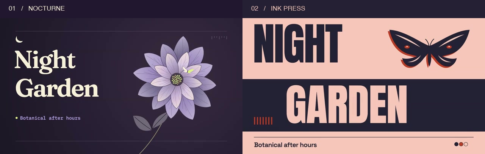

# Night Garden

One brief: an eight-second motion identity for a botanical exhibition after hours. Both films use the same title and supporting copy. Each keeps the lettering, illustration and motion editable.

[](../../docs/assets/showcase/night-garden/compare.mp4)

| Film                                                             | Type and color                                                                            | What moves                                                                                                                             |
| ---------------------------------------------------------------- | ----------------------------------------------------------------------------------------- | -------------------------------------------------------------------------------------------------------------------------------------- |
| [Nocturne](../../docs/assets/showcase/night-garden/nocturne.mp4) | Fraunces display type and IBM Plex Mono on plum, with lilac petals and a citron accent.   | Outer and inner petals open in succession. A moth visits the flower as its pollen catches the light, then the complete title holds.    |
| [Ink Press](../../docs/assets/showcase/night-garden/press.mp4)   | Anton display type and Space Grotesk on shell pink, with dark ink and a vermilion offset. | The red and dark impressions of a cut-paper moth come into register. An ink band reveals GARDEN; the last pass adds the wing markings. |

These are deliberately art-directed examples, not a blind comparison of models. In the first renders the petals looked flat and the print motif resembled a gear. The revised exports add gradients and fine veins to the flower and replace the geometric stamp with a moth. The print headline is optically centered in its band.

## Edit either film

Start this repository's local editor, then from the repository root run:

```sh
node --import tsx examples/art-direction/build.mts
node examples/art-direction/import.mjs test-results/night-garden nocturne
node examples/art-direction/import.mjs test-results/night-garden press
```

Open either returned editor URL. Each import creates a fresh project, with locally bundled fonts. Select a lettering item, choose the nested text in **Graphic layer**, and change the copy or color. The browser can export the edited MP4 without a provider account. The sample editor renders at 1280×720, 30 fps, without audio.

## How this relates to the agent

Default new local v14 runs can discover the [type-and-color guide](../../guides/type-and-color.md) through `read_skill`. Its three directions pair actual available fonts with ground, type, material and cue colors, and explain how to choose motion around the content. The examples illustrate two of the three directions. Use the guide to make a judgment for a new brief, not to insert a fixed template.

New runs that receive this guide save their skill list privately. Older runs keep their original discovery behavior. An explicit `SKILLS_DIR`, an existing local skill with the same name, or a full 32-skill directory takes precedence.

The local reproducible driver reads the guide through the real tool loop and replays the [authored designs](directions.mjs) through `review_edit` and `propose_edit`. It checks exact text, matching applied/reviewed hashes and registered font families. The supplied MP4s are actual editor exports. This verifies tool compatibility and these films' appearance; it does not measure a hosted model's spontaneous choices.
