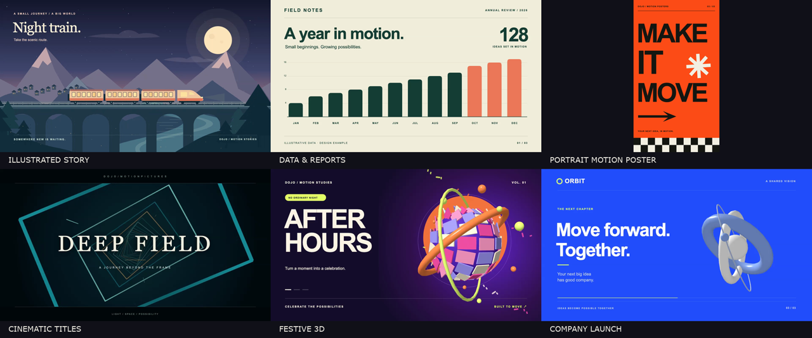
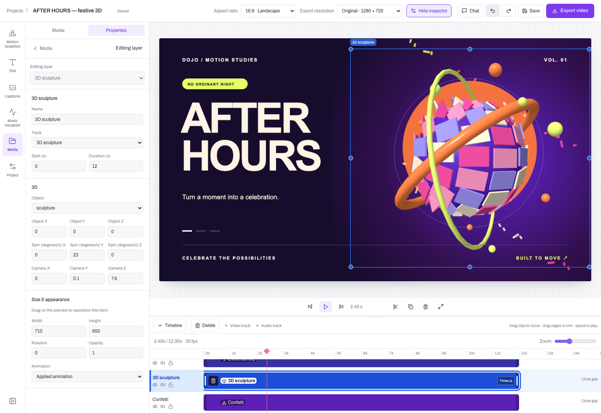

# Make these videos your own

Fifteen supplied designs cover different creative categories:

| Scene                | Category                | Format    |
| -------------------- | ----------------------- | --------- |
| **Night Train**      | Illustrated story       | Landscape |
| **Field Notes**      | Data and reports        | Landscape |
| **Type in Motion**   | Portrait motion poster  | Portrait  |
| **Deep Field**       | Cinematic titles        | Landscape |
| **After Hours**      | Festive 3D              | Landscape |
| **Orbit**            | Company launch          | Landscape |
| **Little Worlds**    | Miniature worlds        | Landscape |
| **Precision / P–01** | Exploded assembly       | Landscape |
| **Chroma Bloom**     | Kinetic vector art      | Landscape |
| **Night League**     | Sports broadcast        | Landscape |
| **Flow**             | Software product demo   | Landscape |
| **Squeeze**          | Food and drink campaign | Landscape |
| **Special Delivery** | Lottie vector story     | Landscape |
| **Make Magic**       | Handwritten lettering   | Landscape |
| **Letter / Form**    | Expressive typography   | Landscape |

[](../../docs/assets/showcase/gallery.mp4)

These are original, code-authored examples from
[Dojo Video Engine](https://github.com/PansaLegrand/dojo-video-engine/tree/main/examples/creative-showcase).
The JSON files here preserve their editable Scene nodes. They are supplied designs,
not recordings of a chat agent generating the videos. ORBIT is a fictional brand.
All fifteen examples are silent and need no external media or API keys.

## Open an editable copy

Start the harness from the repository root:

```sh
npm run launch
```

In another terminal, also at the repository root:

```sh
node examples/creative-showcase/import.mjs journey
node examples/creative-showcase/import.mjs data-story
node examples/creative-showcase/import.mjs kinetic
node examples/creative-showcase/import.mjs cinema
node examples/creative-showcase/import.mjs festival
node examples/creative-showcase/import.mjs company
node examples/creative-showcase/import.mjs city
node examples/creative-showcase/import.mjs precision
node examples/creative-showcase/import.mjs bloom
node examples/creative-showcase/import.mjs sports
node examples/creative-showcase/import.mjs software
node examples/creative-showcase/import.mjs citrus
node examples/creative-showcase/import.mjs lottie
node examples/creative-showcase/import.mjs handwriting
node examples/creative-showcase/import.mjs type-motion
```

Each command creates a new project and prints its editor URL. Open that URL to
play the animation, select a timeline item, change its text or appearance, and
export an MP4. Grouped layers expose their children through **Graphic layer** in
the inspector. Ordinary edits and Undo use the same project history as your own
videos. The import preserves paint order and animation timing; it does not flatten
the design into a video asset.

AFTER HOURS opens as six named tracks: background/light, confetti, the separate
3D sculpture, event identity, three sequential titles, and footer/chapter marks.
Contiguous decorative nodes are wrapped in full-canvas groups so the timeline
stays useful; their original child nodes remain editable. Select **3D sculpture**
to expose the Three.js controls directly. ORBIT keeps its three original chapter
groups as sequential clips on one track. The grouping map is checked against
source node order and rejects an incompatible scene revision.

Night Train has seven independent illustration layers. Field Notes and Type in
Motion each use three sequential chapter clips. Deep Field separates atmosphere,
the editable 3D tunnel, lens treatment and title clips. Every source node remains
editable inside its original group. Little Worlds uses three layers, Precision
uses seven, and Chroma Bloom uses four; their 3D/vector details remain editable.
Night League, Flow and Squeeze each open as three sequential chapter clips.
The software UI, teams, scores and drink brand are fictional design examples.

The script uses the running local host's existing project and command APIs with
revision/hash guards. It does not edit `.data` files directly or call a model.
Running it again creates another independent copy. To use a deliberately
configured local port, pass its origin:

```sh
node examples/creative-showcase/import.mjs festival http://127.0.0.1:4310
```

Validate the supplied Scene and Three.js limits without creating a project:

```sh
node examples/creative-showcase/import.mjs festival --check
node examples/creative-showcase/import.mjs company --check
```

The scenes require a desktop browser with WebCodecs; 3D examples also require
WebGL2. Chromium is the
tested path. Manual editing and export need no provider configuration. Optional
chat revisions use your configured provider and its normal charges.

## Source and licensing

The fifteen `.json` scenes are exported from their matching `.mjs` authors
in the engine's `examples/creative-showcase/` directory, using the published
1.2.3 Scene/Three.js contract. The examples are MIT-licensed with their owning
repositories. Browser font rendering can vary by platform.

## Verification

### November 16 baseline

The initial festival and company scenes were imported through the local HTTP command API, opened in Chromium,
exported from the actual editor, and fully decoded with FFmpeg: 360 frames each,
1280 × 720, 12 seconds. Reload preserved each document; the 390-pixel viewport
had no horizontal overflow. The festival title and Three.js camera were edited
through the inspector, and Undo restored the original document in each case.
No model or generation requests were made.

The four additional categories (Night Train, Field Notes, Type in Motion and
Deep Field) also passed actual-editor export, full FFmpeg decoding, reload and
390-pixel viewport checks. All exported 360 frames; the poster retained its
720 × 1280 portrait format and the other three retained 1280 × 720 landscape.
There were no browser exceptions or provider calls.

Little Worlds, Precision and Chroma Bloom passed the same actual-editor export,
full-decoding, reload and narrow-viewport checks: 360 frames each at 1280 × 720.
Their source scenes and rendered samples were visually reviewed, including the
city shadow and the exploded assembly’s title clearance.

[](../../docs/assets/showcase/editor-festival.png)

The root README features four short MP4 reels: creative directions, 3D/vector
detail, real-world scenarios, and Lottie/lettering.
[Watch the scenario reel](../../docs/assets/showcase/scenarios.mp4).

### November 17 scenario additions

Night League, Flow and Squeeze passed Scene validation, actual browser rendering,
full engine and editor MP4 exports, complete FFmpeg decoding, document reload and
390-pixel viewport checks. Each export contains 360 frames at 1280 × 720. All twelve
imports also passed frame-by-frame native compilation comparison. No model or
generation requests were used.

Native compilation checks compared all 360 frames of all fifteen imported projects with
the original Scene, including node order, animation clocks, layout and 3D
parameters under the host's existing numeric normalization. Source JSON copies
match the engine versions used for the README renders. The
[engine render reports](https://github.com/PansaLegrand/dojo-video-engine/tree/main/docs/reports/showcase)
record the exact source hashes and browser/export evidence.

### Lottie and lettering additions

Special Delivery and Make Magic use original bundled Lottie vector assets. Their
canonical JSON hashes are included in static filenames under `public/assets/showcase`;
imports check those files against the embedded Scene data before creating a project.
Retain the existing hashed files when authoring new versions. No media upload or
provider request is required. Lottie artwork and handwriting paths are edited in
source; the timeline controls the clip. Letter / Form and native captions remain
editable text.

All three passed actual-editor rendering, export, full decoding, reload and
narrow-screen checks: 360 frames each at 1280 × 720. Native compilation preserves
all 360 frames of all fifteen supplied projects.
